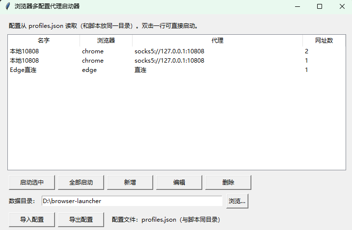

# Browser-launcher

Windows / macOS / Linux 用的 Chrome / Edge / fingerprint-chromium 多配置代理启动器：一个配置 = 一个浏览器 + 一个代理 + 一组网址，每个配置用独立的用户数据目录启动，互不干扰。同一配置的多个网址：第一个开新窗口，后面的开成这个窗口的标签页。每个配置还能单独设启动语言、启动时区、浏览器 exe 路径和指纹参数（见下）。

## 界面截图



## 版本

- browser-launcher.ps1：命令行版（Windows PowerShell），菜单选编号启动；配置写在脚本“配置区”，可填语言、时区、exe 路径、指纹开关及指纹参数
- browser-launcher-gui.ps1：图形界面版（Windows），每配置一个按钮；配置同样写在脚本“配置区”，可填语言、时区、exe 路径、指纹开关及指纹参数
- browser-launcher-visual.ps1：可视化配置版（Windows，推荐），配置存在 profiles.json，界面里可新增、编辑、删除、导入、导出，编辑框里有语言、时区、exe 路径、指纹开关及指纹参数
- browser-launcher.py：跨平台版（Windows / macOS / Linux），界面用各系统自带的 tkinter，功能与可视化配置版相同
- BrowserLauncher.CSharp：C# Windows 图形界面版，支持 profiles.json 读写、新增/编辑/删除配置、导入/导出、启动选中或全部配置；exe 可从 Releases 下载

### C# 版下载与运行

在 [Releases](https://github.com/panyong29/Browser-launcher/releases) 下载最新的 `BrowserLauncher.CSharp.exe`，无需单独安装 .NET。首次运行时会在 exe 同目录生成 `profiles.json`；把它与其他版本共用时，建议先备份配置文件。该版本面向 Windows x64，启动的浏览器仍需预先安装。

源码构建需要 .NET 8 SDK：

```powershell
dotnet publish .\BrowserLauncher.CSharp\BrowserLauncher.CSharp.csproj -c Release -r win-x64 --self-contained true -p:PublishSingleFile=true -p:IncludeNativeLibrariesForSelfExtract=true
```

推送 `csharp-v*` 格式的标签（例如 `csharp-v1.0.0`）会自动构建 Windows x64 单文件 exe 并创建 GitHub Release。

## 运行

Windows PowerShell 版：

    powershell -ExecutionPolicy Bypass -File .\browser-launcher-visual.ps1

跨平台版（Windows 上用 python / py，不要用 python3，WindowsApps 下的 python3 只是应用商店占位程序）：

    python browser-launcher.py

macOS / Linux 跨平台版：

    python3 browser-launcher.py

macOS 请用官网或 Homebrew 装的 Python 3，系统自带的 /usr/bin/python3 没有 tkinter；Linux 缺 tkinter 时，Ubuntu/Debian 执行 sudo apt install python3-tk。

PowerShell 版是 UTF-8 带 BOM 编码，Windows PowerShell 5.1 可直接运行；用记事本改完另存时保持 UTF-8 编码。

## 配置

profiles.json 是示例配置，和 PowerShell 版格式通用，两个版本可以共用：

- baseDir：各配置的用户数据目录存放位置
- 每个配置：名字、浏览器（chrome / edge / fingerprint）、代理（留空 = 直连）、网址（第一个开新窗口，后面的开成标签页）
- 每个配置还可填：启动语言（lang，留空 = 跟系统，如 en-US、zh-CN）、启动时区（timezone，留空 = 跟系统，IANA 名字如 America/New_York、Asia/Shanghai）、浏览器 exe 路径（browser_path，通用字段，填了且文件存在就优先用它，留空自动找，不属于指纹选项）、指纹开关（use_fingerprint，仅 fingerprint 用，见下）、指纹种子（fingerprint_seed，仅 fingerprint 用，见下）、操作系统（fingerprint_platform，仅 fingerprint 用，如 windows、linux、macos，留空 = 不强制）、关闭伪装（disable_spoofing，仅 fingerprint 用，逗号分隔，如 font,audio,canvas,clientrects,gpu，留空 = 全开）

## 启动语言、启动时区和指纹（跨平台版与 PowerShell 版通用）

- 启动语言：填了就传 `--lang` 和 `--accept-lang`，各系统都生效。
- 启动时区：原版 Chrome / Edge 没有 `--timezone` 参数，时区默认跟系统；Linux / macOS 下本脚本用 `TZ` 环境变量给子进程传时区，能生效；Windows 下原版浏览器填了时区也不会生效，启动器只会在日志里明说，不会假装已生效。
- fingerprint 浏览器例外：它是打了指纹补丁的改版 Chromium，自带 `--timezone` 补丁，启动时传 `--timezone=<时区>`，Windows 下也能生效。浏览器选 `fingerprint`，并在“浏览器 exe 路径”里填它自己的 exe（一般在安装目录的 `Application\chrome.exe`），留空时按常见 Chromium 安装位置自动找。
- 指纹开关（use_fingerprint）：浏览器选 `fingerprint` 时才显示，关了就不传 `--fingerprint`，只用语言、时区、代理，这是只想设置语言和时区、不想开任何伪装时的用法；开了才展开下面参数（指纹种子、关闭伪装、操作系统）。浏览器 exe 路径是通用字段，不属于指纹选项，开关关了也照常显示。`--fingerprint` 必须带 32 位整数种子，裸传 `--fingerprint` 是错的；开关开了、种子留空时按配置名自动生成固定种子（跨平台版用 CRC32，PowerShell 版用同一算法的 CRC32，两边同一配置名算出同一种子）。旧配置没有开关字段时，浏览器是 `fingerprint` 的默认开、是 chrome / edge 的默认关。
- PowerShell 版注意：本机 Linux 环境没有 PowerShell，`ps1` 版无法在本机实跑，只能做括号平衡、字段和脱敏检查；Windows 上首次运行时请先核对：可视化版编辑框里浏览器选 `fingerprint` 时开关出现、开关开/关时种子等三格展开/收起，exe 路径始终可见；种子留空时启动日志里的种子应与跨平台版一致（校验：配置名 `HK_chromium` 留空时种子应为 `-1744200419`）。
- 关闭伪装（disable_spoofing）：仅在传了指纹种子时有意义，逗号分隔，可填的 5 类是 `font,audio,canvas,clientrects,gpu`，全关就填 `font,audio,canvas,clientrects,gpu`。注意：Windows 上 fingerprint 150 版手动测试多次出现 Aw Snap / Crashpad_NotConnectedToHandler，但二次测试结果完全不同，时区、种子、画布/元素尺寸等结论均未复现，目前无可靠定论；唯一一次用户报告能用的组合是 `--fingerprint=2023 --fingerprint-platform=windows --disable-spoofing=gpu`，且用户随后确认起作用的是 `--disable-spoofing=gpu` 这一项。GPU 伪装的崩溃原理：伪装报了一套按种子算出的 GPU 参数，真实显卡驱动兑现不了，页面一调用 WebGL 渲染进程就死掉；关掉 GPU 伪装后报的就是真实显卡参数，页面就能正常跑。复测须用全新数据目录、彻底关进程、同一组参数跑两次结果一致才算数。
- 验 GPU 伪装是否关掉：在浏览器里按 F12，进 Console 输一段 WebGL 代码读 `UNMASKED_VENDOR_WEBGL` / `UNMASKED_RENDERER_WEBGL`，与任务管理器 → 性能 → GPU 里的真实显卡名对比；或换一个种子再跑一次，输出不变就是真显卡，换种子就换显卡就是还在伪装。
- 验时区：在 fingerprint 打开的浏览器里按 F12，进 Console 输 `Intl.DateTimeFormat().resolvedOptions().timeZone`，显示的时区应是你填的那个，而不是系统时区。

示例里的代理地址是占位符（你的服务器IP），用前改成自己的代理地址。带账号密码的 SOCKS5 代理，浏览器第一次启动时会弹窗让填账号密码。

## 默认打开的网站

可视化版和跨平台版默认每个配置先打开 https://ippure.com/ （测 IP 纯净度），再开配置里的其他网址；不想要的话在界面里编辑删掉即可。
